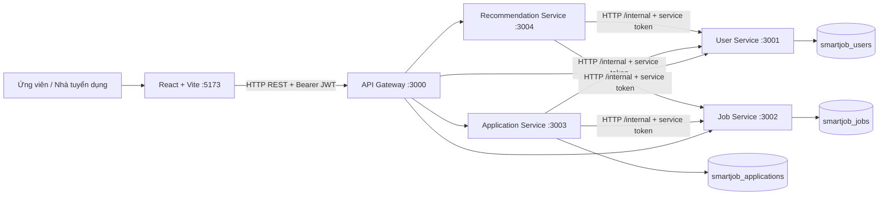
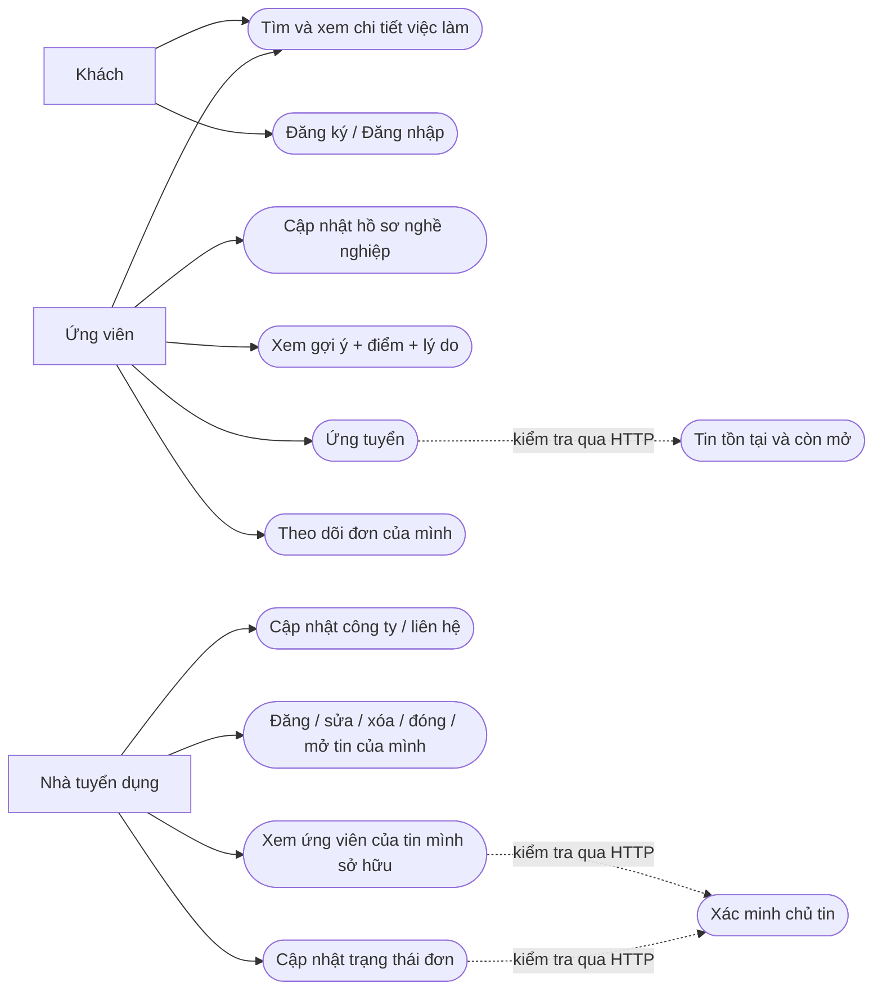
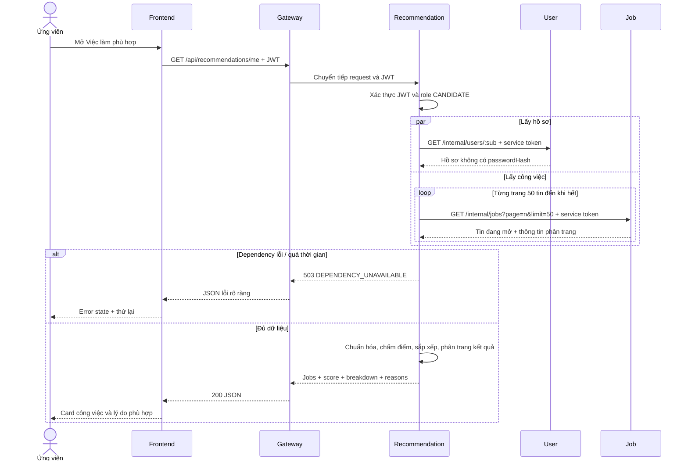

# 2. Kiến trúc SOA

## Ranh giới nghiệp vụ và quyền sở hữu dữ liệu

| Service        | Trách nhiệm                                  | Port | Database              | Phụ thuộc HTTP |
| -------------- | -------------------------------------------- | ---- | --------------------- | -------------- |
| User           | Danh tính, mật khẩu, vai trò, hồ sơ          | 3001 | smartjob_users        | Không          |
| Job            | Tin tuyển dụng, tìm kiếm, chủ tin            | 3002 | smartjob_jobs         | Không          |
| Application    | Nộp đơn, snapshot, xét duyệt                 | 3003 | smartjob_applications | Job và User    |
| Recommendation | Phối hợp hồ sơ + công việc, tính điểm        | 3004 | Không                 | User và Job    |
| Gateway        | Chuyển tiếp public API, biên CORS/rate limit | 3000 | Không                 | Cả bốn service |

Các service là ứng dụng Express độc lập. Mỗi service có `src/index.js`, `app.js`, routes, controllers, services và config. Service gọi ra ngoài có `clients`; service có dữ liệu có `models`. Middleware dùng chung nằm trong workspace shared, validation nghiệp vụ nằm tại service tương ứng. Không tạo thư mục rỗng cho lớp không dùng.



MongoDB có thể là cùng một tiến trình local với ba database logic. Đây là tách biệt quyền sở hữu dữ liệu ở cấp kiến trúc ứng dụng; bản demo chưa cấu hình ba MongoDB credential riêng. Source của mỗi service chỉ chứa model của chính nó. Khi triển khai thật có thể dùng ba URI/credential và mạng riêng mà giữ nguyên contract HTTP.

## Use case

Mermaid không có cú pháp use-case UML riêng; sơ đồ dưới biểu diễn tác nhân và use case bằng flowchart.



## Sequence: gợi ý việc làm



Gateway có timeout riêng; nếu toàn bộ request quá hạn tại gateway, client nhận `504`. Các service chạy tiếp và vẫn phản hồi `/health` sau khi dependency ngừng.

## Sequence: ứng tuyển

```mermaid
sequenceDiagram
    actor C as Ứng viên
    participant F as Frontend
    participant G as Gateway
    participant A as Application
    participant J as Job
    participant U as User
    participant D as smartjob_applications
    C->>F: Gửi lời giới thiệu + ứng tuyển
    F->>G: POST /api/applications {jobId, coverLetter} + JWT
    G->>A: Chuyển tiếp request
    A->>A: Kiểm tra JWT, role, input; candidateId lấy từ sub
    par Xác minh công việc
        A->>J: GET /internal/jobs/:jobId + service token
        J-->>A: Job + status + recruiterId
    and Lấy hồ sơ
        A->>U: GET /internal/users/:candidateId + service token
        U-->>A: Hồ sơ ứng viên
    end
    alt Tin không tồn tại hoặc đã đóng
        A-->>G: 404 hoặc 409
        G-->>F: Thông báo phù hợp
    else Tin còn mở
        A->>D: Insert đơn + snapshot, unique(jobId,candidateId)
        alt Đã ứng tuyển hoặc gửi đồng thời
            D-->>A: Duplicate key
            A-->>G: 409 DUPLICATE
        else Thành công
            D-->>A: Application
            A-->>G: 201 Created
        end
        G-->>F: Kết quả JSON
        F-->>C: Thông báo và lịch sử ứng tuyển
    end
```

Khi nhà tuyển dụng xem ứng viên hoặc đổi trạng thái, Application Service lấy job qua HTTP và so sánh `job.recruiterId` với JWT `sub`. Không dùng `recruiterId` client tự gửi. Ứng viên xem lịch sử bằng filter `candidateId = JWT.sub`.

## Bốn đặc điểm của SOA thể hiện trong đồ án

**Business-Driven:** chia service theo năng lực nghiệp vụ (quản lý người dùng, việc làm, ứng tuyển, gợi ý). Endpoint phản ánh tác vụ của ứng viên và nhà tuyển dụng, thay vì chia theo từng bảng hoặc widget UI.

**Vendor-Neutral:** hợp đồng HTTP/JSON và Bearer token không phụ thuộc JavaScript của client. Có thể viết Recommendation Service bằng Python hoặc thay frontend mà vẫn giữ contract. MongoDB/Mongoose là lựa chọn triển khai hiện tại, không phải định dạng trao đổi bắt buộc của toàn hệ thống. Các `_id` trong API là chuỗi 24 ký tự, nên client vẫn cần tuân theo contract ID này khi thay backend.

**Enterprise-Centric:** các năng lực và quy tắc được dùng thống nhất toàn hệ thống. User Service là nguồn hồ sơ; Job Service là nguồn tin; quyền sở hữu được kiểm tra ở backend. Nhiều ứng dụng giao diện có thể dùng chung các dịch vụ. Phạm vi doanh nghiệp ở đây là hệ thống đồ án thu gọn, chưa phải đầy đủ hạ tầng enterprise.

**Composition-Centric:** Recommendation Service phối hợp User + Job để tạo danh sách gợi ý; Application phối hợp Job + User để kiểm tra và chụp hồ sơ trước khi lưu đơn. Giá trị nghiệp vụ được tạo bởi sự phối hợp nhiều service qua contract thực tế.

## Loose Coupling, Reusability và Service Contract

- **Loose Coupling:** các service chỉ biết URL, header và JSON contract. Không import model hoặc đọc database của nhau. Mỗi tiến trình có thể restart độc lập. HTTP đồng bộ vẫn tạo phụ thuộc khả dụng; timeout và lỗi `503` làm rõ phụ thuộc đó, không xóa bỏ nó.
- **Reusability:** `GET /internal/jobs/:id` được dùng khi ứng tuyển và xác minh chủ tin; hồ sơ User được dùng trong Recommendation và snapshot Application. Shared workspace tái sử dụng auth/validation/error handling nhưng không gom nghiệp vụ vào một server chung.
- **Service Contract:** mô tả method, path, input, output, authentication và status. Ví dụ `GET /internal/users/:id` cần `x-service-token`, trả `{data: user}` và không có password hash; client không phụ thuộc schema MongoDB nội bộ. Contract được ghi tại [tài liệu API](03-api.md).

Không dùng ESB hoặc service registry trong bản local; gateway và URL trong env là lựa chọn đơn giản phù hợp bốn service. Đây vẫn là kiến trúc SOA có ranh giới nghiệp vụ, contract và composition, không bắt buộc SOAP/XML.
